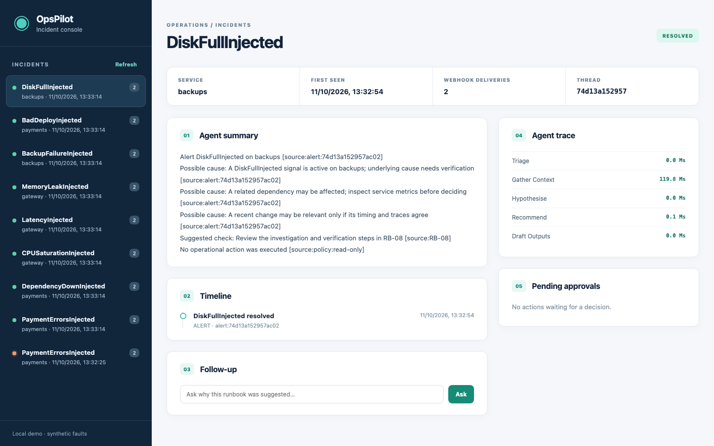

# OpsPilot

OpsPilot brings a service alert, its surrounding evidence, relevant runbooks, and an operator's decision into one local incident workflow. Synthetic faults exercise the path from Prometheus alerts to a stateful investigation and web console. Draft ticket changes require a separate approval step.



## Why this project

An alert is usually the start of an investigation, not its conclusion. This project brings metrics, traces, runbooks, and recent incidents into one local workflow so an operator can trace a proposed action back to evidence before approving it.

## Milestones

| Plan milestone | Where it stands |
|---|---|
| M1: alert path | All eight synthetic fault types reached the local webhook in one integration test. The resource faults are simulated. |
| M2: mock systems and knowledge | Mock incident/backup APIs and ingestion run locally. Full-corpus reranked runbook Recall@5 was 0.675 on 40 authored development queries, versus 0.475 for BM25 alone. In a separate 32-scenario development check, adding alert symptoms to the agent's runbook search raised mean expected-runbook recall among five chunks from 0.469 to 0.891. On 40 separately authored questions, full-corpus reranking hit 31/40 and vector search 32/40; direct runbook-filtered hybrid hit 40/40. These are different synthetic tests; the LLM was not rerun. |
| M3: anomaly detection | The guarded STL/MAD + IsolationForest detector found 32/32 injected episodes on the synthetic development set, with sample precision 0.835. Live triage also scores pre-alert Prometheus samples and reads bounded Tempo traces; one controlled fault verified context delivery, not detector accuracy. |
| M4–M5: agent and operator channels | An investigation thread survived an API restart; the local console shows its context and pending actions. Slack/Teams adapters have local tests, but real channel delivery is unverified. Ticket writes need a separate approval request. |
| M6–M8: evaluation and hardening | A dated 40-case local Qwen comparison, a separate eight-case prompt diagnostic, read-only MCP tools, policy-case checks, and a kind smoke are recorded. The historical false-alarm rule missed cause IDs in recommendations; the later diagnostic uses a corrected rule and found 0/4 complete abstentions on selected false alarms. Semantic citation support (a blinded 30-pair review packet is ready, unlabelled) and production-like faults remain unverified. |

The next evidence milestone is a human review of whether the actual model's cited sources support its claims. Source-ID validity alone cannot answer that question. The review is prepared but not done. A full 40-scenario run of the local Ollama `qwen2.5:0.5b` exported 933 claim/source pairs to `eval/citation_review/`. `eval/citation_packet.py build` drew a seeded sample of 30 of the 332 eligible pairs into a blinded packet, with two empty label sheets that show only an item ID, the claim and the cited source. Two labellers follow the [citation rubric](docs/CITATION_RUBRIC.md). `eval/citation_packet.py score` then reports support precision with Wilson intervals, Cohen's kappa between the labellers and consensus precision, and it refuses missing or invalid labels. The key that maps items back to scenarios is kept out of this repository until labelling is finished. **No human labels exist yet**, so citation precision is unmeasured. Denominators and limits are in [RESULTS.md](RESULTS.md).

The agent's runbook and similar-incident tools now search with the alert's service, description, summary and name, capped at 500 characters. The [predeclared comparison](docs/RETRIEVAL_QUERY_PROTOCOL.md) and [dated result](RESULTS.md#symptom-aware-agent-retrieval-development-check-26-october-2026) cover the authored alert scenarios. A [separately authored question set](RESULTS.md#separately-authored-runbook-query-holdout-26-october-2026) tests direct retrieval from the same synthetic runbooks; it does not test the alert-to-query step or real incident generalization. Human citation-support labels remain open.

The graph saves complete investigation context, then sends a bounded view of recent metrics, logs, traces, distinct runbooks and service-relevant backup jobs to an opt-in model. Offline tests verify that projection. A [selected eight-case Ollama diagnostic](RESULTS.md#31-october-prompt-context-checkpoint-and-limited-ollama-diagnostic) found false-alarm and citation failures; it does not establish a prompt improvement. The local deterministic backend remains the default, and the hosted Gemini backend is opt-in with a separate limited check in RESULTS.

## Run locally

You need Docker Desktop, Python 3.12, uv; Node.js for the web console.

```sh
make install
make up
make seed
make ingest
make fault NAME=payment_errors DURATION=120
make test
```

The API is at `http://127.0.0.1:18100`; Grafana is at `http://127.0.0.1:18130`. Run `make web-install && make web-dev` for the console, and `make down` when finished. [Architecture](docs/ARCHITECTURE.md), [chat adapters](docs/CHAT.md), and [security notes](docs/SECURITY.md) describe the service boundaries.

With the corpus indexed in PostgreSQL, run `python eval/agent_retrieval_eval.py --out /tmp/opspilot-query-check.json` to reproduce the old-versus-current agent query comparison on authored scenarios. It tests retrieval only and does not call Ollama.

`make demo` first creates healthy gateway traffic, then injects a bounded payment fault and shows the saved anomaly and Tempo context for the firing alert. `make test` now runs pytest through the project Python; its [1 November offline check](RESULTS.md#offline-test-entry-point-check--1-november-2026) passed 69 tests with two integration skips. The integration path needs the matching Compose services and `OPSPILOT_INTEGRATION=1`.

The exact separately authored queries, frozen scoring protocol, evaluator and per-query output are saved under `eval/` and `docs/`; see [the result table](RESULTS.md#separately-authored-runbook-query-holdout-26-october-2026). The labelled question set has already been used for evaluation and should not be reused for tuning.

## Repository map

`infra/` defines the observability stack; `scripts/` seeds and exercises it; `web/` is the operator view; `docs/` covers architecture and security boundaries.

## Scope

Faults, incidents, and the default triage backend are synthetic. Slack and Teams adapters have local tests but no live channel run. The approval token is a local demo control, not production identity.
