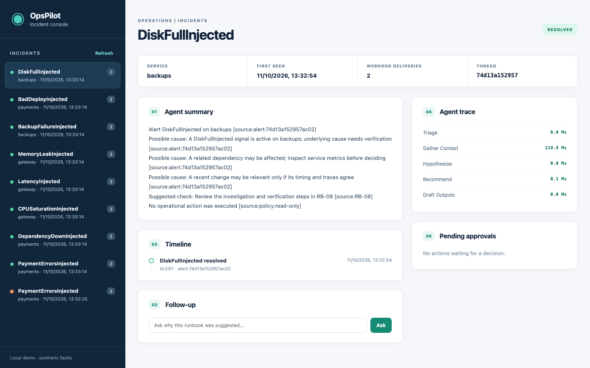

# OpsPilot

OpsPilot brings a service alert, its surrounding evidence, relevant runbooks, and an operator's decision into one local incident workflow. Synthetic faults exercise the path from Prometheus alerts to a stateful investigation and web console. Draft ticket changes require a separate approval step.



## Why this project

An alert is usually the start of an investigation, not its conclusion. This project brings metrics, traces, runbooks, and recent incidents into one local workflow so an operator can trace a proposed action back to evidence before approving it.

## Milestones

| Plan milestone | Where it stands |
|---|---|
| M1: alert path | All eight synthetic fault types reached the local webhook in one integration test. The resource faults are simulated. |
| M2: mock systems and knowledge | Mock incident/backup APIs and ingestion run locally. Reranked runbook Recall@5 was 0.675 on 40 authored development queries, versus 0.475 for BM25 alone. |
| M3: anomaly detection | The guarded STL/MAD + IsolationForest detector found 32/32 injected episodes on the synthetic development set, with sample precision 0.835. |
| M4–M5: agent and operator channels | An investigation thread survived an API restart; the local console shows its context and pending actions. Slack/Teams adapters have local tests, but real channel delivery is unverified. Ticket writes need a separate approval request. |
| M6–M8: evaluation and hardening | A local Qwen comparison, read-only MCP tools, policy-case checks, and a kind smoke are recorded. Semantic citation support and production-like faults remain unverified. |

The next evidence milestone is a human review of whether the actual model's cited sources support its claims. Source-ID validity alone cannot answer that question. Denominators and limits are in [RESULTS.md](RESULTS.md).

## Run locally

You need Docker Desktop, Python 3.12, uv; Node.js for the web console.

```sh
make install
make up
make seed
make ingest
make fault NAME=payment_errors DURATION=120
make test
```

The API is at `http://127.0.0.1:18100`; Grafana is at `http://127.0.0.1:18130`. Run `make web-install && make web-dev` for the console, and `make down` when finished. [Architecture](docs/ARCHITECTURE.md), [chat adapters](docs/CHAT.md), and [security notes](docs/SECURITY.md) describe the service boundaries.

## Repository map

`infra/` defines the observability stack; `scripts/` seeds and exercises it; `web/` is the operator view; `docs/` covers architecture and security boundaries.

## Scope

Faults, incidents, and the default triage backend are synthetic. Slack and Teams adapters have local tests but no live channel run. The approval token is a local demo control, not production identity.
