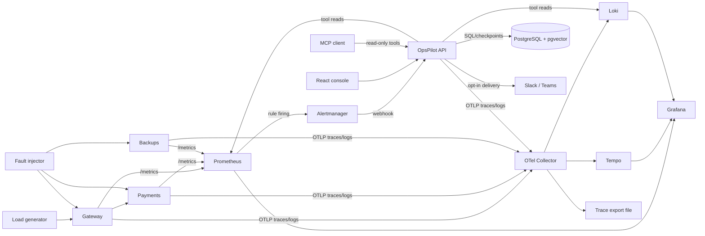

# OpsPilot architecture and design decisions

## System boundary

OpsPilot is a **local demonstration system**. Its gateway, payments, and backups services are synthetic workloads; its incident, change, backup, and deployment records are mock data. It can investigate and draft changes, but cannot deploy or approve a change. The Docker Compose path runs the complete observed stack. The Helm chart currently deploys the API, three workloads, and PostgreSQL for a Kubernetes smoke test; observability services run in Compose.

## Alert-to-answer path

1. The injector asks one demo app to activate a fault for a bounded duration, then appends the accepted event to `eval/fault_log.jsonl`. `/work` generates observable request outcomes and durations. Resource labels simulate pressure; they do not exhaust the host.
2. Prometheus scrapes counters, histograms, and fault gauges every five seconds. Alert rules fire into Alertmanager, which posts to `/api/alertmanager/webhook`. The direct fault gauges validate routing but are excluded from the anomaly benchmark.
3. `AlertEvent.fingerprint` deduplicates retried webhooks. A new firing transition starts one LangGraph thread. PostgreSQL checkpoint rows preserve that thread across API restarts.
4. The graph executes `triage → gather_context → hypothesise → recommend → draft_outputs`. Context gathering calls seven validated tools concurrently. PromQL and LogQL are selected from fixed templates, so model text cannot run arbitrary queries. Search uses BM25, BGE embeddings in pgvector, RRF, and optional cross-encoder reranking.
5. The backend returns structured claims. A source-ID check rejects IDs missing from gathered evidence and retries once. This is an existence check, **not** proof that the text is supported. The default backend is a deterministic fixture; local Ollama is opt-in.
6. A ticket note or change request is stored as a pending action. Only a separate operator request with the local approval token can apply it to mock ITSM. No approval token is configured by default.
7. The console reads persisted incidents and checkpoint state. Slack/Teams delivery requires explicit credentials and `OPSPILOT_CHAT_DELIVERY=1`. Chat buttons acknowledge or draft; they never approve.

## Observability and causality

Each FastAPI app and outgoing HTTPX call is instrumented with OTel. Graph nodes and tool calls create spans. OTLP HTTP goes to the collector; Tempo stores traces, Loki stores logs, and a collector file exporter provides recent spans for dependency inference. The correlator links caller and callee only when a trace contains cross-service parent and child span IDs. If there is no trace file, it reports a static graph fallback. Prometheus scrapes `opspilot_agent_runs_total`, agent duration histograms, tool-call counters, and workload metrics. Grafana's provisioned health dashboard plots them and displays firing alerts. The local verification observed a `gateway → payments` edge and queried a real trace ID in Tempo.

Anomaly scoring is separate from alert routing. STL/MAD uses only the prefix seen at each scoring point; IsolationForest trains on a separate healthy sample and has a range guard for constant features. The local development set has 32 injected episodes, but resource effects are simulated and thresholds were tuned while inspecting the set. See `RESULTS.md` before making a performance claim.

## Persistence and failure behavior

PostgreSQL stores mock API records, source chunks, 384-dimensional embeddings, alert fingerprints, pending actions, chat thread maps, change reviews, and LangGraph checkpoints. The API uses SQLAlchemy `create_all` on startup; a production deployment needs migrations. The `pgvector` extension is installed before the knowledge table. The Compose PostgreSQL volume survives `make down` and is removed only with `docker compose down -v`.

An unavailable Loki URL produces an explicit `available: false` tool result. A model with invented source IDs gets one retry and then a cautious fallback. Alert retries increment a delivery counter on one fingerprint; they do not create duplicate investigations. Chat delivery failures are logged without undoing the investigation. Unknown freeze-calendar state results in `NEEDS INFO`. An approval token missing from configuration disables writes.

## Deployment choices and limits

Compose is the full local demo path because it fits the small laptop and supports direct fault/telemetry inspection. `charts/opspilot` is an isolated Kubernetes smoke deployment with a one-replica API and demo services, plus a PostgreSQL PVC. It does not include kube-prometheus-stack, Loki, Tempo, or the collector yet. The chart's default PostgreSQL secret value is **demo-only** and must be overridden with a real secret mechanism outside this environment. The CI workflow runs lint, type checking, unit tests, Compose integration, image builds, and kind smoke. GHCR publication is possible only through a manually dispatched workflow with `publish=true`; this local work made no push.

## Production changes

- Replace mock ServiceNow/backup/deployment adapters with authenticated enterprise clients; keep the validated tool interface and read-only default.
- Use OIDC user identity and role checks for approvals; sign the Alertmanager webhook; store secrets in a managed secret store.
- Move from `create_all` to migrations; add idempotency keys and an outbox for reliable chat delivery.
- Test retrieval and diagnosis on held-out, de-identified real incidents, including counterfactual and prompt-injection cases. Add human-labeled semantic citation checks.
- Run real resource-failure experiments in a disposable cluster and measure alert-to-summary latency end to end.
- Replace local file trace export with a service graph generated from an indexed trace backend; bound retention and cardinality.
